<p align="center">
  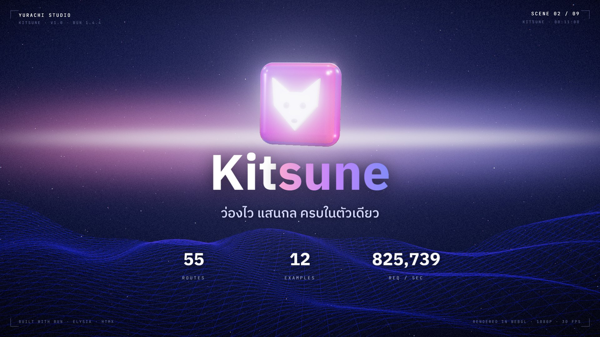
</p>

<h1 align="center">🦊 Kitsune</h1>

<p align="center">
  <strong>ว่องไว แสนกล ครบในตัวเดียว</strong><br />
  Full-stack starter บน <b>Bun + Elysia + htmx</b> — backend และ frontend ในโปรเจกต์เดียว เร็ว เบา type-safe
</p>

<p align="center">
  <a href="https://github.com/KCCHDEV/Kisune-WebServer/actions/workflows/ci.yml"></a>
  
  
  
  
  <a href="LICENSE"></a>
  
</p>

<p align="center">
  <a href="#-เริ่มใช้งานใน-30-วินาที">เริ่มใช้งาน</a> ·
  <a href="#-ฟีเจอร์">ฟีเจอร์</a> ·
  <a href="#-ความเร็ว">ความเร็ว</a> ·
  <a href="#-ตัวอย่างพร้อมใช้">ตัวอย่าง</a> ·
  <a href="#-วิดีโอ-trailer">Trailer</a> ·
  <a href="#-คู่มือ">คู่มือ</a>
</p>

---

## ✨ ฟีเจอร์

<table>
  <tr>
    <td width="33%" valign="top">
      <h3>📁 สร้างไฟล์ = ได้ route</h3>
      File-based routing ทั้งหน้าเว็บและ API รองรับ <code>[id]</code>, <code>[...slug]</code>, <code>(group)</code>, WebSocket และ <code>_guard.ts</code> ป้องกันทั้งโฟลเดอร์
    </td>
    <td width="33%" valign="top">
      <h3>⚡ เร็วตั้งแต่ไม่ต้องจูน</h3>
      Elysia คอมไพล์ handler ล่วงหน้า + JSX เป็น string ตรงๆ (ไม่มี virtual DOM) — หลักแสน req/s ต่อ CPU core เดียว
    </td>
    <td width="33%" valign="top">
      <h3>🧠 In-memory cache</h3>
      Cache แบบ Redis ในตัวแอพ (TTL, LRU, <code>remember()</code>) จำกัด 128 MB · cache ทั้งหน้าด้วย <code>export const cache = 60</code>
    </td>
  </tr>
  <tr>
    <td valign="top">
      <h3>🗜️ บีบอัด + ETag</h3>
      หน้าที่ cache ถูกบีบ brotli/gzip ไว้ล่วงหน้า (เล็กลง ~73%) · เข้าซ้ำได้ 304 · ไฟล์ static cache ใน browser ได้ 1 ปี
    </td>
    <td valign="top">
      <h3>✅ Type-safe ทั้งระบบ</h3>
      ประกาศ schema ด้วย <code>t.Object</code> ครั้งเดียว ได้ทั้ง validation, TypeScript type และเอกสาร OpenAPI อัตโนมัติ
    </td>
    <td valign="top">
      <h3>🔁 htmx ไม่ต้องเขียน JS</h3>
      ส่ง HTML ชิ้นเล็กๆ ไปมา · SSE, WebSocket, infinite scroll, ค้นหาสด และโหลดหน้าล่วงหน้าตอนกดเมาส์
    </td>
  </tr>
  <tr>
    <td valign="top">
      <h3>🛡️ ปลอดภัยไว้ก่อน</h3>
      ตรวจ XSS ตอนคอมไพล์ (<code>xss-scan</code>) · cookie เซ็นลายเซ็น · กัน path traversal · validation ทุก input
    </td>
    <td valign="top">
      <h3>🖥️ Console สวย อ่านง่าย</h3>
      Banner, ตาราง route แยกตาม method และ request log สีพร้อมป้าย <code>htmx</code> · <code>nav</code> · <code>cache</code> · ผู้ใช้
    </td>
    <td valign="top">
      <h3>🎬 Trailer ด้วย WebGL</h3>
      วิดีโอแนะนำโปรเจกต์ 80 วินาที render สดด้วย three.js + เพลงสังเคราะห์ — ส่งออก MP4 1080p ด้วยคำสั่งเดียว
    </td>
  </tr>
</table>

## 🚀 เริ่มใช้งานใน 30 วินาที

ต้องมี [Bun](https://bun.sh) 1.4 ขึ้นไป — สร้างโปรเจกต์ใหม่ด้วยคำสั่งเดียว แบบ `create-next-app`:

```bash
bun create KCCHDEV/Kisune-WebServer my-app
cd my-app
bun dev
```

ระหว่างสร้างจะถามชื่อแอพ และให้เลือกแม่แบบ:

| แม่แบบ | ได้อะไร |
| --- | --- |
| **Full** (ค่าเริ่มต้น) | ตัวอย่างครบ 12 หมวด + benchmark + cache demo — เหมาะกับลองเล่นและเรียนรู้ |
| **Minimal** | โครงเปล่าสะอาด: หน้าแรก, `/api/hello`, `/api/health`, เทส — เหมาะกับเริ่มงานจริง |

แล้วจะเตรียมให้อัตโนมัติ: ตั้งชื่อแอพในเว็บ · `.env` พร้อม secret สุ่ม · ติดตั้ง dependency · git repository · README ของโปรเจกต์

<details>
<summary><b>ตัวเลือกเพิ่มเติม</b> — ข้ามคำถาม, ใช้ <code>bunx create-kitsune</code>, หรือ clone เอง</summary>

```bash
# ผ่าน create-kitsune (หลัง publish ขึ้น npm) — ส่งตัวเลือกเพื่อข้ามคำถามได้
bunx create-kitsune my-app --template minimal --name "My Shop" --yes
bun create kitsune my-app

# clone repo ตรงๆ (ได้ทุกไฟล์ รวมถึงตัวอย่างและ trailer)
git clone https://github.com/KCCHDEV/Kisune-WebServer.git kitsune
cd kitsune && bun install && bun dev
```

| ตัวเลือก | ความหมาย |
| --- | --- |
| `--template full\|minimal` | เลือกแม่แบบ |
| `--name "My App"` | ชื่อแอพที่แสดงในเว็บ |
| `--trailer` | เก็บวิดีโอ trailer (WebGL) ไว้ด้วย (แม่แบบ Full) |
| `--no-install` / `--no-git` | ไม่ติดตั้ง dependency / ไม่สร้าง git |
| `-y`, `--yes` | ใช้ค่าเริ่มต้น ไม่ถาม |

</details>

เปิด **http://localhost:3000** แล้วลองดูได้เลย:

| หน้า | มีอะไร |
| --- | --- |
| `/` | Landing page + วัดความเร็วสดจากเซิร์ฟเวอร์ |
| `/examples` | ตัวอย่าง 12 หมวด แต่ละหน้าแสดงโค้ดจริงของตัวเอง |
| `/benchmark` | ทดสอบความเร็ว: in-process, HTTP load test (p50 / p95 / p99 + histogram) |
| `/trailer` | วิดีโอ trailer render สดด้วย WebGL (มีเสียง) + ปุ่มส่งออก MP4 |
| `/openapi` | เอกสาร API อัตโนมัติ (Scalar) |

## 📸 หน้าตา

<table>
  <tr>
    <td width="50%">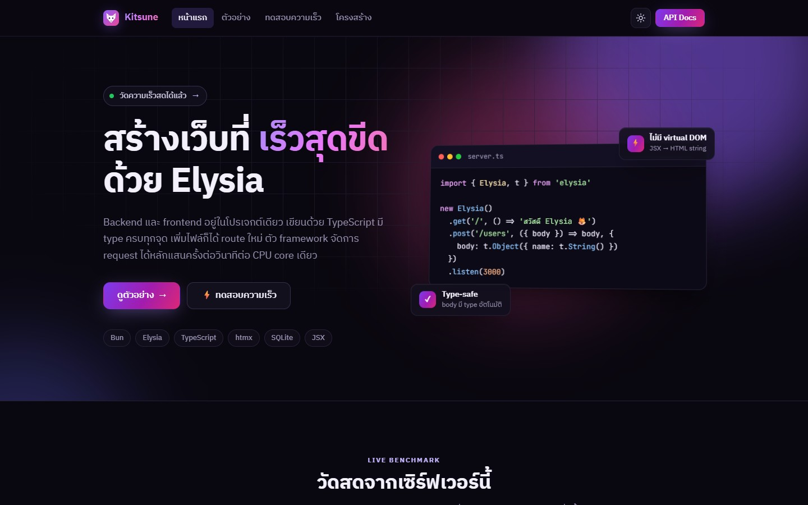<br /><sub><b>หน้าแรก</b> — วัดความเร็วสดทุกครั้งที่เปิด</sub></td>
    <td width="50%">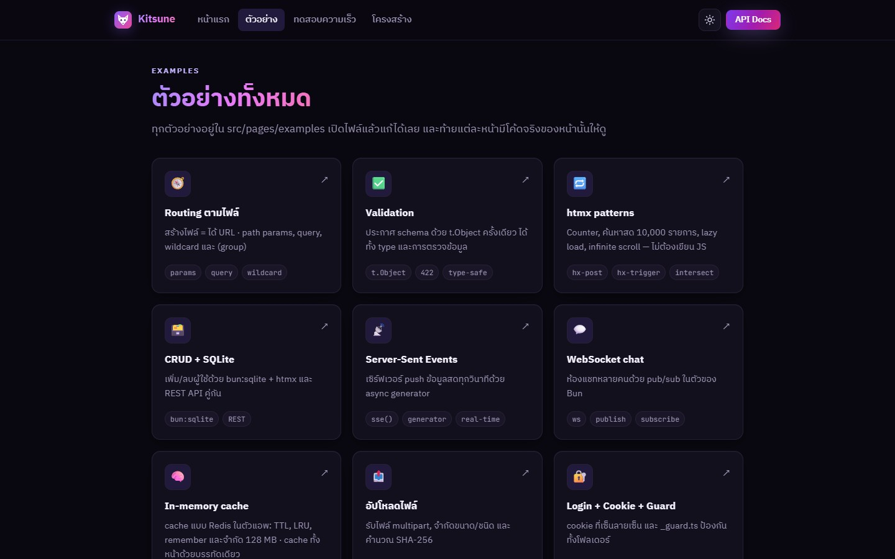<br /><sub><b>ตัวอย่าง 12 หมวด</b> — พร้อมโค้ดจริง</sub></td>
  </tr>
  <tr>
    <td>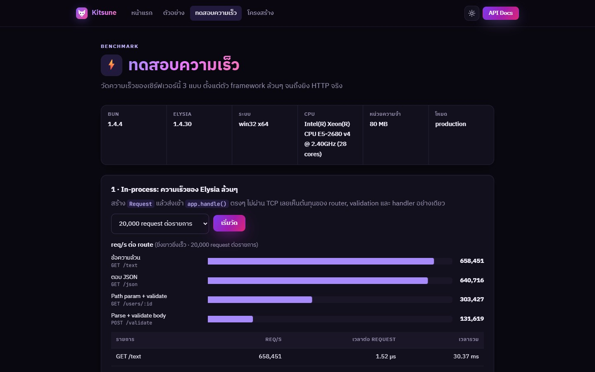<br /><sub><b>ทดสอบความเร็ว</b> — req/s ต่อ route</sub></td>
    <td>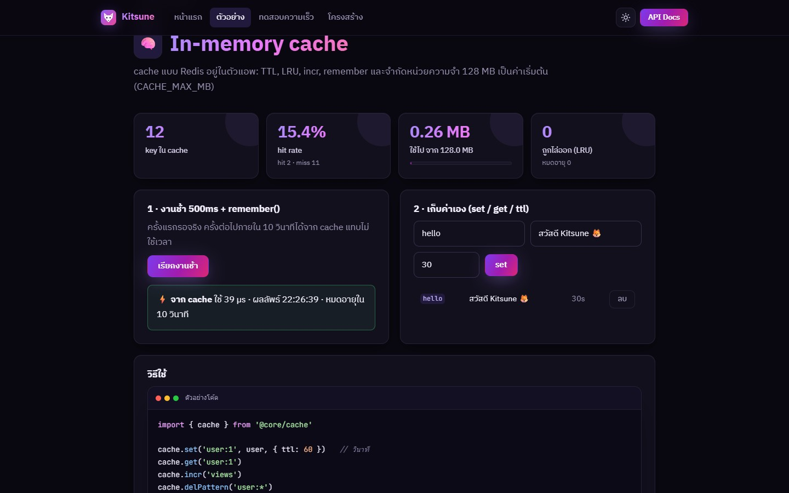<br /><sub><b>In-memory cache</b> — สถิติสด, remember(), set / get / ttl</sub></td>
  </tr>
</table>

<p align="center">
  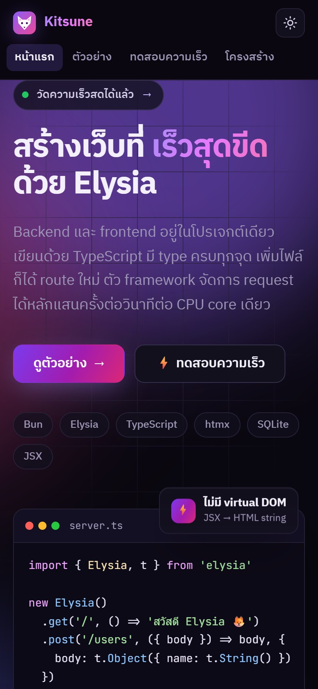
  &nbsp;
  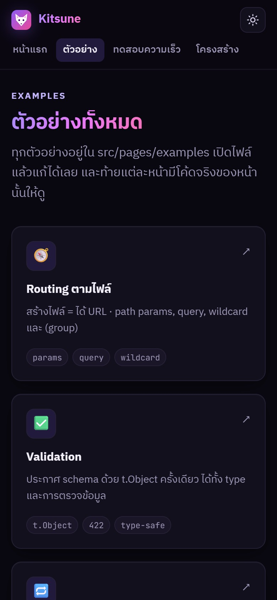
  &nbsp;
  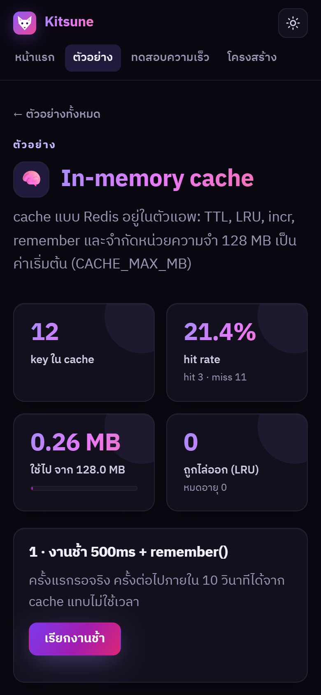
  <br /><sub>รองรับมือถือ · ธีมสว่าง / มืด</sub>
</p>

## ⚡ ความเร็ว

วัดบน Intel Xeon E5-2680 v4 · Windows · Bun 1.4.4 · โหมด production (`LOG=0`) — **ตัวเลขบนเครื่องคุณจะต่างไป** ลองรันเองได้ที่ `/benchmark` หรือ `bun run bench`

**In-process** (ยิงเข้า `app.handle()` ตรงๆ ไม่ผ่าน network, CPU 1 core)

| Route | req/s |
| --- | ---: |
| `GET /text` ข้อความล้วน | ~550,000 – 820,000 |
| `GET /json` | ~450,000 – 680,000 |
| `GET /users/:id` + validate | ~220,000 – 380,000 |
| `POST /validate` parse + validate body | ~110,000 – 160,000 |

**HTTP** (`bun run bench`, ยิง 64 พร้อมกัน — ตัวยิงอยู่เครื่องเดียวกัน จึงเป็นตัวจำกัดเอง)

| Endpoint | req/s | p99 |
| --- | ---: | ---: |
| `/api/bench/text` | 23,378 | 5.3 ms |
| `/api/bench/json` | 23,578 | 5.9 ms |
| `/api/bench/db` อ่าน SQLite 1 แถว | 17,286 | 7.2 ms |
| `/api/bench/html` render JSX 50 แถวทุกครั้ง | 3,996 | 25.7 ms |
| `/api/bench/cached` ตารางเดียวกันจาก cache | **14,356** | 8.3 ms |

> หน้าเดิมที่ cache แล้วตอบใน **~0.3 ms** (render ครั้งแรก ~3 ms) และขนาดที่ส่งเล็กลง **~73%** ด้วย brotli

## 🧪 ตัวอย่างพร้อมใช้

| | ตัวอย่าง | สิ่งที่ได้เรียน |
| --- | --- | --- |
| 🧭 | [Routing ตามไฟล์](src/pages/examples/routing) | params, query, wildcard, `(group)` |
| ✅ | [Validation](src/pages/examples/validation.tsx) | `t.Object` → 422 พร้อมข้อความภาษาไทย |
| 🔁 | [htmx patterns](src/pages/examples/htmx) | counter, ค้นหาสด 10,000 รายการ, lazy load, infinite scroll |
| 🗃️ | [CRUD + SQLite](src/pages/users) | `bun:sqlite` + htmx + REST API |
| 📡 | [Server-Sent Events](src/pages/examples/sse) | push ข้อมูลสดด้วย async generator |
| 💬 | [WebSocket chat](src/pages/examples/websocket) | pub/sub ในตัวของ Bun |
| 🧠 | [In-memory cache](src/pages/examples/cache) | TTL, LRU, `remember()` |
| 📤 | [อัปโหลดไฟล์](src/pages/examples/upload.tsx) | `t.File`, จำกัดขนาด, SHA-256 |
| 🔐 | [Login + Cookie + Guard](src/pages/examples/auth) | cookie เซ็นลายเซ็น, `_guard.ts`, redirect |
| 📖 | เอกสาร API อัตโนมัติ | OpenAPI + Scalar ที่ `/openapi` |
| 🧪 | [Testing](tests) | `bun test` + `app.handle()` ไม่ต้องเปิดพอร์ต |
| ⚡ | [ทดสอบความเร็ว](src/pages/benchmark) | req/s, p50 / p95 / p99, histogram |

## 🎬 วิดีโอ Trailer

วิดีโอแนะนำโปรเจกต์ 80 วินาที **render ด้วย WebGL ล้วนๆ** (three.js) — โมเดล 3D, ภาพหน้าจอจริงของเว็บ และตัวเลขที่วัดจากเซิร์ฟเวอร์ตอน render ดนตรีสังเคราะห์สดด้วย WebAudio (ไม่มีไฟล์เพลง)

<table>
  <tr>
    <td width="33%">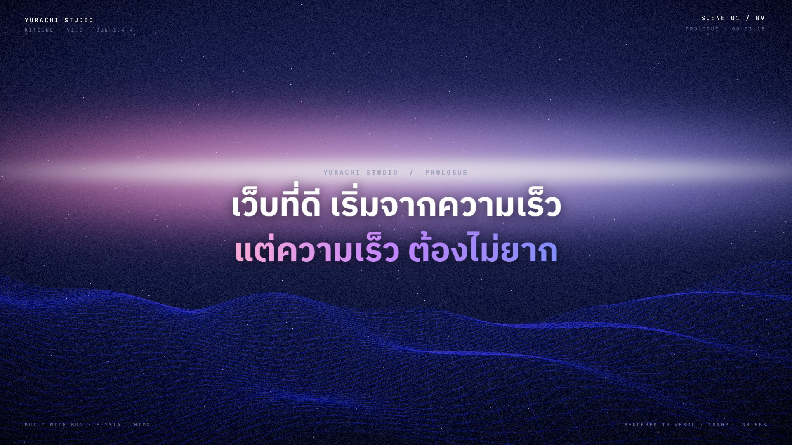</td>
    <td width="33%">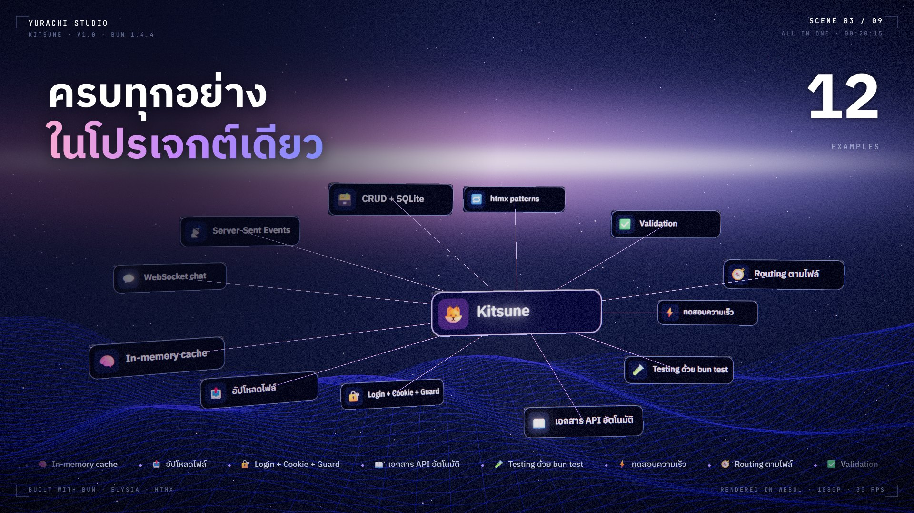</td>
    <td width="33%">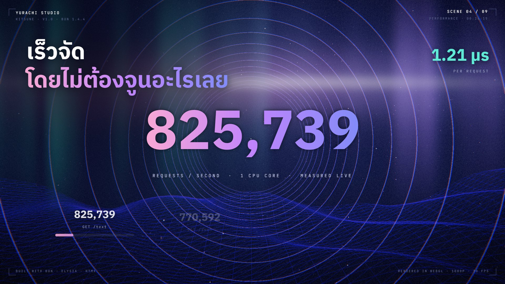</td>
  </tr>
  <tr>
    <td>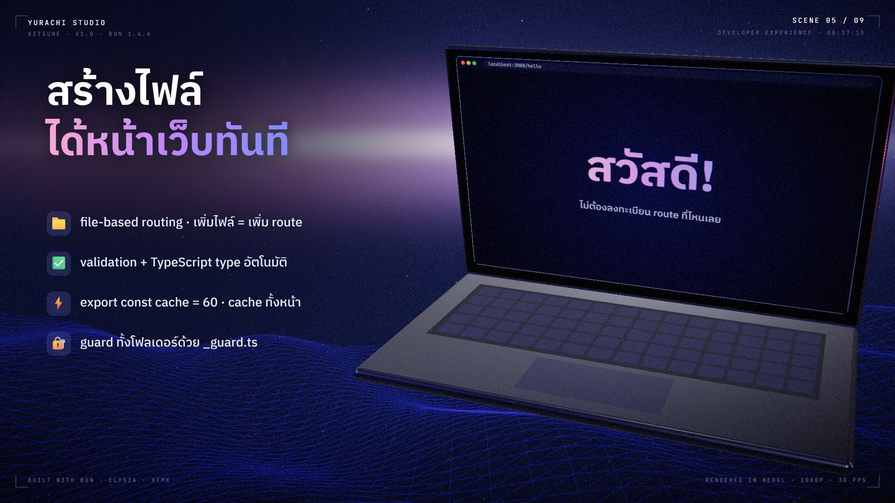</td>
    <td>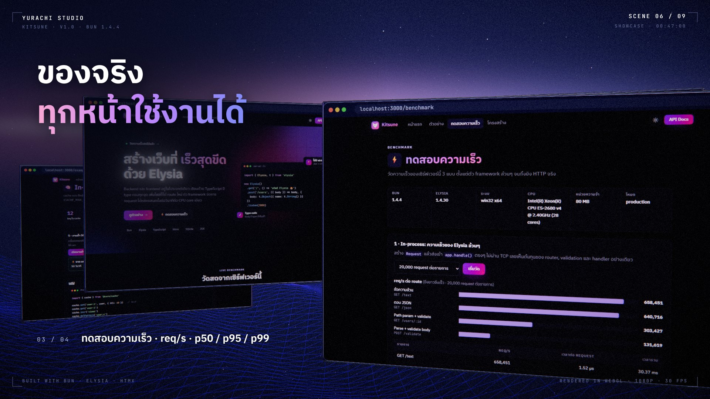</td>
    <td>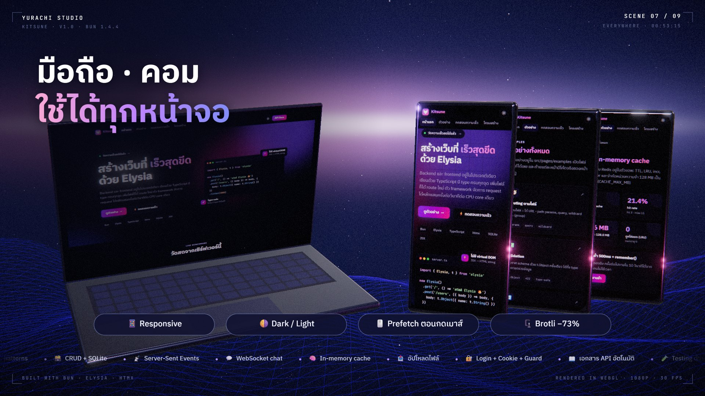</td>
  </tr>
  <tr>
    <td>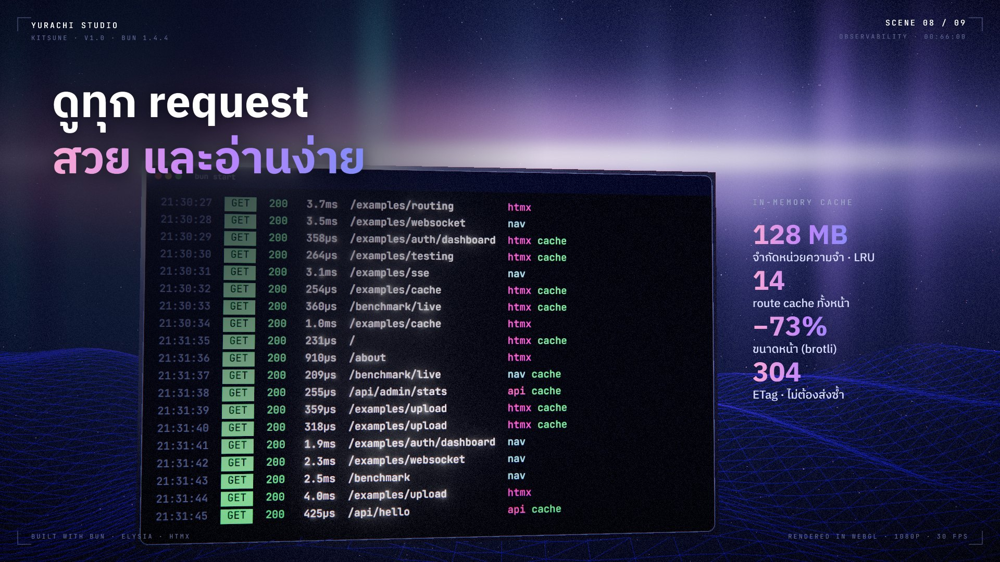</td>
    <td colspan="2">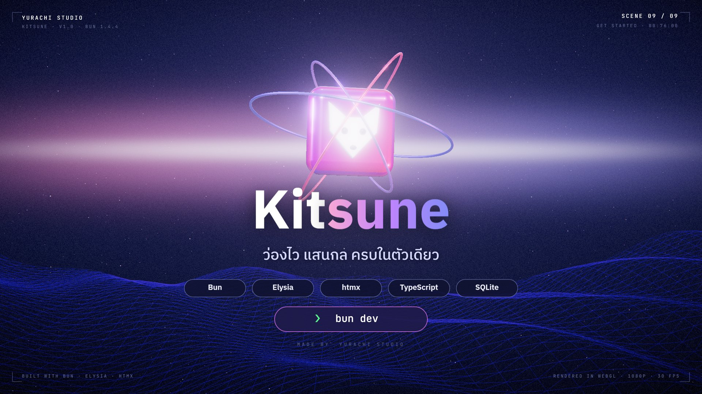</td>
  </tr>
</table>

```bash
bun run trailer                                   # → dist/kitsune-trailer.mp4 (1080p 30fps, H.264 + AAC)
bun run trailer -- --frames 11 --jpg --out shots   # ภาพนิ่งบางวินาที
```

ใช้ Edge / Chrome ที่มีในเครื่องแบบ headless (กำหนดเองได้ด้วย `BROWSER=...`) เข้ารหัสด้วย WebCodecs — ไม่ต้องมี ffmpeg

## 📚 คู่มือ

### โครงสร้างโปรเจกต์

```
index.tsx              จุดเริ่มต้น — createApp() แล้ว listen
core/                  ระบบเบื้องหลัง (ปกติไม่ต้องแก้)
  app.ts               plugin, error handler, Server-Timing (ใช้ทั้งเซิร์ฟเวอร์และเทส)
  router.ts            file-based router (+ WebSocket, + cache ทั้งหน้า)
  route.ts             defineRoute / defineGuard / defineSocket
  cache.ts             in-memory cache แบบ Redis (LRU + TTL)
  http-cache.ts        cache ทั้ง response + brotli / gzip + ETag
  static.ts            เสิร์ฟ /public และ /vendor จากหน่วยความจำ
  logger.ts            console: banner, ตาราง route, request log
src/
  api/                 JSON API → /api/...
  pages/               หน้าเว็บ JSX + htmx → /...
  components/          import { X } from '@components'
  lib/                 db.ts, bench.ts, examples.ts ฯลฯ
public/                ไฟล์ static → /public/...
trailer/               วิดีโอ trailer (WebGL + WebAudio)
tests/                 bun test
scripts/               bench.ts · cluster.ts · trailer.ts · setup/ (ตั้งค่าโปรเจกต์ใหม่)
packages/create-kitsune  คำสั่ง bunx create-kitsune (ดาวน์โหลดแม่แบบ + รัน setup)
```

### Routing ตามชื่อไฟล์

| ไฟล์ | URL |
| --- | --- |
| `src/pages/index.tsx` | `/` |
| `src/pages/about.tsx` | `/about` |
| `src/pages/users/[id].tsx` | `/users/:id` |
| `src/pages/docs/[...slug].tsx` | `/docs/*` |
| `src/pages/(shop)/cart.tsx` | `/cart` — วงเล็บ = จัดกลุ่ม ไม่ขึ้นใน URL |
| `src/api/users/index.ts` | `/api/users` |
| `_ชื่อไฟล์.ts` / `_folder/` | ไม่เป็น route |

### API

```ts
// src/api/products.ts → /api/products
import { defineRoute, t } from '@core/route'

export const GET = () => [{ id: 1, name: 'RTX 5090' }]

export const POST = defineRoute({
  body: t.Object({ name: t.String() }),
  handler: ({ body }) => ({ created: body.name }), // body มี type ให้เลย
})
```

### หน้าเว็บ + htmx

```tsx
// src/pages/contact.tsx → /contact
import { Layout, Card, Button } from '@components'

export const cache = 60 // cache ทั้งหน้า 60 วินาที (เฉพาะหน้าที่ไม่ขึ้นกับผู้ใช้)

export default function Contact() {   // export default = GET
  return (
    <Layout title="ติดต่อ" path="/contact">
      <Card title="ติดต่อเรา">
        <Button hx-post="/contact" hx-target="#msg">ส่ง</Button>
        <p id="msg"></p>
      </Card>
    </Layout>
  )
}

export const POST = () => <span>ได้รับแล้ว ✅</span>  // htmx เอาไปแปะใน #msg
```

### In-memory cache

```ts
import { cache } from '@core/cache'

cache.set('user:1', user, { ttl: 60 })   // ttl = วินาที
cache.get('user:1')
cache.incr('views')
cache.delPattern('user:*')

// คำนวณครั้งเดียวแล้วจำไว้ — request ที่มาพร้อมกันตอน miss จะรอผลเดียวกัน
const list = await cache.remember('users:all', 30, () => db.query('...').all())
```

จำกัดหน่วยความจำ **128 MB** (`CACHE_MAX_MB`) · เต็มแล้วไล่ตัวที่ไม่ได้ใช้นานที่สุดออก · ดูสถิติที่ `GET /api/cache`

### WebSocket · Guard · Components

- **WebSocket** — ไฟล์ไหน `export const WS = defineSocket({ open, message, close })` ได้ WebSocket ที่ path นั้น ([ตัวอย่าง](src/pages/examples/websocket/socket.ts))
- **Guard** — `_guard.ts` ใช้กับทุก route ในโฟลเดอร์และโฟลเดอร์ลูก ([ตัวอย่าง](src/api/admin/_guard.ts))
- **Components** — วางไฟล์ `.tsx` (PascalCase, `export default`) ใน `src/components` แล้ว `import { X } from '@components'` ได้ทันที
- **XSS** — ข้อมูลจากผู้ใช้ใส่ `safe` เสมอ: `<p safe>{user.name}</p>` · `bun run check` ตรวจให้ทั้งโปรเจกต์

### คำสั่ง

| คำสั่ง | ทำอะไร |
| --- | --- |
| `bun create KCCHDEV/Kisune-WebServer my-app` | สร้างโปรเจกต์ใหม่ (ถามชื่อ + แม่แบบ) |
| `bun dev` | โหมดพัฒนา (auto-reload เมื่อแก้/เพิ่ม/ลบไฟล์) |
| `bun start` | โหมด production |
| `bun run start:cluster` | production ทุก CPU core (Linux, `reusePort`) |
| `bun test` | รันเทสทั้งหมด |
| `bun run check` | ตรวจ TypeScript + XSS |
| `bun run bench` | ยิงโหลดใส่เซิร์ฟเวอร์ที่เปิดอยู่ |
| `bun run trailer` | สร้างวิดีโอ trailer เป็น MP4 |

### Environment

| ตัวแปร | ค่าเริ่มต้น | หมายเหตุ |
| --- | --- | --- |
| `PORT` | `3000` | |
| `DB_FILE` | `data.sqlite` | |
| `COOKIE_SECRET` | `dev-cookie-secret` | **เปลี่ยนใน production** |
| `ADMIN_KEY` | `dev-secret` | **เปลี่ยนใน production** |
| `CACHE_MAX_MB` | `128` | หน่วยความจำสูงสุดของ cache |
| `WORKERS` | จำนวน core | ใช้กับ `start:cluster` |
| `LOG` | `1` | `0` = ปิด request log |
| `LOG_STATIC` / `LOG_BENCH` | `0` | `1` = log `/public` / `/api/bench` ด้วย |
| `NO_COLOR` / `FORCE_COLOR` | | ปิด / บังคับสีใน console |

### Deploy

```bash
NODE_ENV=production COOKIE_SECRET=... ADMIN_KEY=... bun start
```

แนะนำให้มี reverse proxy (Caddy / nginx) ด้านหน้าสำหรับ HTTPS · หน้าที่ cache ถูกบีบอัดไว้แล้ว ส่วน response อื่นให้ proxy บีบอัดให้
ถ้ารันหลายเครื่องหรือหลาย worker และต้องการ cache ร่วมกัน ให้เปลี่ยน `core/cache.ts` ไปใช้ Redis

## 🤝 ร่วมพัฒนา

ยินดีรับ issue และ pull request — อ่าน [CONTRIBUTING.md](CONTRIBUTING.md) ก่อนเริ่ม · พบช่องโหว่ด้านความปลอดภัย ดู [SECURITY.md](SECURITY.md)

## 📄 License

[MIT](LICENSE) © 2026 **Yurachi Studio**

<p align="center">
  <sub>สร้างด้วย 🦊 โดย <b>Yurachi Studio</b> · ขับเคลื่อนด้วย <a href="https://bun.sh">Bun</a>, <a href="https://elysiajs.com">Elysia</a> และ <a href="https://htmx.org">htmx</a></sub>
</p>
